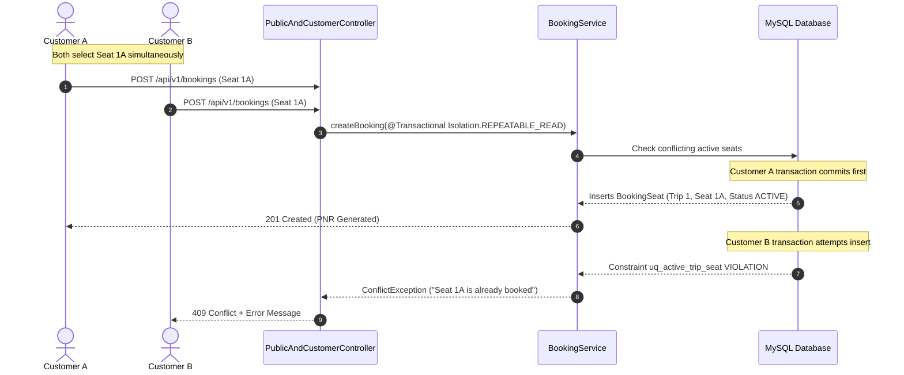

# TransitSync: Business Logic & Rules Engine

## 1. Fare Calculation Formula

All monetary calculations are performed strictly on the backend to prevent client-side price tampering.

$$\text{Base Total} = N_{\text{seats}} \times \text{Base Fare}$$

$$\text{Tax Amount} = \frac{\text{Base Total} \times \text{Tax Rate \%}}{100}$$

$$\text{Grand Total} = \text{Base Total} + \text{Tax Amount} + \text{Fixed Service Fee}$$

### Example:
- Selected: 2 Seats (L1, L2)
- Base Fare: ₹950.00
- Tax Rate: 5% (configured in `system_settings`)
- Service Fee: ₹25.00 (configured in `system_settings`)
- $\text{Base Total} = 2 \times 950 = \text{₹}1900.00$
- $\text{Tax Amount} = \frac{1900 \times 5}{100} = \text{₹}95.00$
- $\text{Grand Total} = 1900.00 + 95.00 + 25.00 = \text{₹}2020.00$

---

## 2. Dynamic Refund Policy

When a customer or administrator cancels a booking, the refund percentage is dynamically calculated based on the hours remaining until departure:

| Hours Remaining ($H$) | Refund Percentage | Formula Applied |
| :--- | :--- | :--- |
| $H \ge 24$ hours | **90%** of total amount | $\text{Refund} = \text{Total} \times 0.90$ |
| $12 \le H < 24$ hours | **50%** of total amount | $\text{Refund} = \text{Total} \times 0.50$ |
| $H < 12$ hours | **0%** (Non-refundable) | $\text{Refund} = \text{₹}0.00$ |

All tiers and percentages are loaded dynamically from the `system_settings` table and can be tuned by administrators in the settings panel without redeployment.

---

## 3. Double-Booking Prevention Architecture

