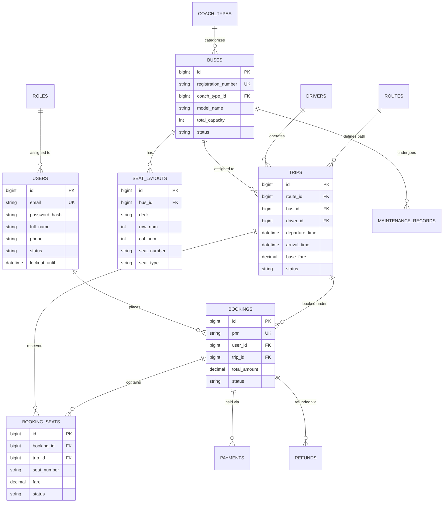

# TransitSync: Relational Database Schema & Data Dictionary

## 1. Entity-Relationship Overview

## 2. Table Specifications & Constraints

### `roles`
- `id`: BIGINT AUTO_INCREMENT PRIMARY KEY
- `name`: VARCHAR(50) NOT NULL UNIQUE (`ROLE_CUSTOMER`, `ROLE_ADMIN`)

### `users`
- `id`: BIGINT AUTO_INCREMENT PRIMARY KEY
- `email`: VARCHAR(120) NOT NULL UNIQUE
- `password_hash`: VARCHAR(255) NOT NULL (BCrypt hashed)
- `full_name`: VARCHAR(100) NOT NULL
- `phone`: VARCHAR(20)
- `role_id`: BIGINT NOT NULL (FK -> `roles.id`)
- `status`: VARCHAR(20) NOT NULL DEFAULT 'ACTIVE' (`ACTIVE`, `INACTIVE`)
- `failed_login_attempts`: INT NOT NULL DEFAULT 0
- `lockout_until`: DATETIME NULL (Rate-limiting lockout)

### `buses` & `seat_layouts`
- `buses.registration_number`: Unique registration license plate
- `buses.status`: `ACTIVE`, `IN_MAINTENANCE`, `RETIRED`
- `seat_layouts`: Unique composite constraint `(bus_id, seat_number)` ensures no duplicates on a bus.

### `booking_seats` (Double-Booking Prevention)
- `trip_id`: BIGINT NOT NULL (FK -> `trips.id`)
- `seat_number`: VARCHAR(10) NOT NULL (e.g. 1A, L1, U1)
- `status`: VARCHAR(30) NOT NULL DEFAULT 'ACTIVE' (`ACTIVE`, `CANCELLED`)
- **Unique Constraint**: `uq_active_trip_seat` on `(trip_id, seat_number, status)`. Ensures two active bookings cannot share the same physical seat for a given trip.
